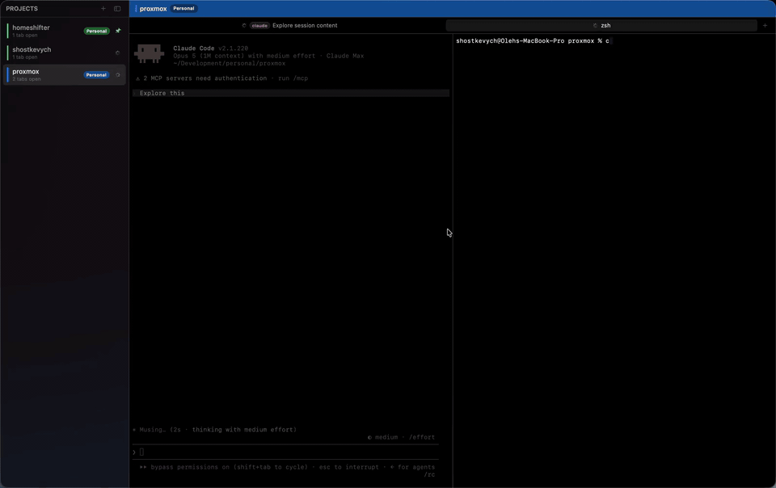

<p align="center">
  
</p>

<h1 align="center">Liftoff</h1>

<p align="center"><b>The terminal for the AI-agent era.</b><br>
A native macOS terminal for engineers who run coding agents across many projects at once.<br>
Watch and steer Claude Code, Codex, Gemini and more — from your Mac, your phone, or any browser.</p>

<p align="center"><a href="https://liftoff.shostkevych.com">liftoff.shostkevych.com</a> · <a href="https://liftoff.shostkevych.com/download">Download for macOS</a> · <a href="https://apps.apple.com/us/app/liftoff-air/id6780915535">Liftoff Air on the App Store</a></p>

<p align="center">
  
</p>

---

## Features

- **Projects × terminals** — top-level tabs per project folder, nested terminal tabs and split panes per project, each running its own agent session.
- **Agent-aware** — detects when Claude Code (or opencode) is working, waiting for input, or done; shows per-session status at a glance and native macOS notifications with project-aware titles.
- **Liftoff Air (iOS companion)** — pair your iPhone by scanning a QR code and monitor or drive every session from your phone over the local network, with end-to-end encrypted traffic. [Get it on the App Store](https://apps.apple.com/us/app/liftoff-air/id6780915535).
- **Web access** — a bundled browser client lets you check on sessions from any device.
- **Native & fast** — SwiftUI + [SwiftTerm](https://github.com/migueldeicaza/SwiftTerm) with a Metal-accelerated renderer. No Electron, no account, and no terminal data collection.
- **Auto-updates** — signed and notarized releases delivered via [Sparkle](https://sparkle-project.org).

## Repository layout

| Path | What it is |
|---|---|
| `macos/Liftoff/` | macOS app (SwiftUI) |
| `macos/LiftoffAir/` | iOS companion app |
| `macos/SwiftTerm/` | vendored fork of [migueldeicaza/SwiftTerm](https://github.com/migueldeicaza/SwiftTerm) (MIT) |
| `web/` | bundled web client served by the app |
| `site/` | Next.js marketing site |
| `macos/scripts/` | release pipeline: build, sign, notarize, DMG, appcast |
| `macos/project.yml` | [XcodeGen](https://github.com/yonaskolb/XcodeGen) project definition |

## Building from source

Requirements: Xcode 16+, [XcodeGen](https://github.com/yonaskolb/XcodeGen) (`brew install xcodegen`).

```bash
git clone https://github.com/<you>/liftoff.git
cd liftoff/macos
xcodegen                      # regenerates Liftoff.xcodeproj from project.yml
open Liftoff.xcodeproj        # build the Liftoff (macOS) or LiftoffAir (iOS) scheme
```

The checked-in project uses the author's signing team; switch the targets to your own team (or automatic signing) in Xcode, or edit `DEVELOPMENT_TEAM` in `project.yml` and rerun `xcodegen`.

Release builds (`macos/scripts/release.sh`, `macos/scripts/build-dmg.sh`) additionally need a Developer ID certificate and a `notarytool` keychain profile — see the comments at the top of each script.

## Website hosting

The public website runs on Next.js 16 and Node.js 24. Import this GitHub repository
into Vercel, choose the **Next.js** preset, and set **Root Directory** to `site`.
Use `npm ci` to install, `npm run build` to build, and the default output settings.
Select the production branch containing the website changes.

Add `liftoff.shostkevych.com` in Vercel's domain settings and replace its former
Cloudflare Tunnel DNS record with the record Vercel provides. Keep DNS at
Cloudflare; changing nameservers is unnecessary. The production hostname must
remain public so Sparkle can fetch `/appcast.xml` without authentication.

`/download` resolves the latest DMG on GitHub Releases. The signed Sparkle feed
is committed at `site/public/appcast.xml` and references ZIPs on GitHub Releases;
application binaries are excluded from website deployments. Legacy versioned
`/releases/Liftoff-<version>.zip` and `/dmg/Liftoff-<version>.dmg` URLs redirect
to their matching GitHub release assets.

For future macOS releases, install the Vercel CLI and run `vercel login` and
`vercel link` from the **repository root**, selecting the imported website project.
The existing `./release.sh <version> <build>` workflow publishes the signed DMG/ZIP
to GitHub, commits and pushes the generated update feed, then deploys the website
with `vercel deploy --prod`. Signing and notarization credentials stay on the Mac;
the website needs no secrets or environment variables.

## License

[MIT](LICENSE). The vendored SwiftTerm fork keeps its original MIT license and copyright.
